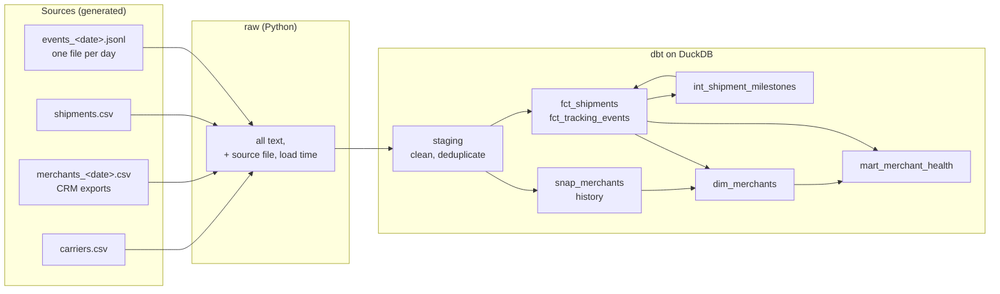

# Shipping analytics

A small analytics engineering project: raw shipping data in, a tested merchant health
table out. Customer Success can use that table to see which merchants need a call.

All data is made up. A script generates it, with errors and business events added on purpose.

## The question

> Which merchants are shipping less, or getting a bad delivery experience, and why?

An account manager should not have to dig through tracking events to find out. They
should open the CRM and see a status and a reason: *"at risk: only 80% on time, mostly GLS"*.

## How it works



| Step | Where | What it does |
|---|---|---|
| Generate | `generator/generate_data.py` | 90 days of data for 200 merchants: ~32k shipments, ~124k tracking events |
| Load | `ingest/load_raw.py` | Loads files as text into schema `raw`. Checks columns and empty files first. Tracking events load incrementally: a daily file is loaded once |
| Stage | `transform/models/staging/` | Casts types, cleans carrier codes, removes duplicate rows and events, flags invalid weights |
| Snapshot | `transform/snapshots/` | Keeps the history of each merchant's plan and country (SCD type 2) |
| Model | `transform/models/marts/` | One row per shipment with delivery performance, then one row per merchant with health status |
| Test | everywhere | 28 dbt data tests, 1 dbt unit test, 5 pytest tests, source freshness, lint in CI |

## What the data quality layer catches

Errors in the generated sources, and how the pipeline handles each:

| Problem in the source | Handling | Result in this run |
|---|---|---|
| The shipment export repeats rows | Deduplicated in `stg_shipments` | 293 duplicate rows removed |
| The tracking API sends some events twice | Deduplicated in `stg_tracking_events` | 637 duplicate events removed |
| Carrier codes as `dhl`, ` DHL `, `DHL` | Trimmed and upper-cased | One code per carrier |
| A legacy carrier code (`DHLX`) nobody mapped | Test **warns**, does not fail. The row stays, as carrier "Unknown" | 154 shipments, listed for the data owner |
| Negative weights | Value set to empty, row kept, `has_invalid_weight` flag | 96 shipments |

Why warn and not fail for the unknown code: the shipments are real and should count in
volumes. Stopping the whole pipeline for a mapping problem would hide good data from everyone.

## The merchant health rules

| Status | Rule |
|---|---|
| churned | 50+ shipments in the previous 30 days, none in the last 30 |
| at_risk | volume down 30% or more, **or** under 85% on time (with 30+ delivered parcels) |
| watch | volume down 15% or more |
| healthy | everything else |

The minimum volumes came from looking at the first results. With a minimum of 20, 56 of
200 merchants were flagged, and 24 of them were small merchants whose volume naturally
swings from month to month. Customer Success would stop trusting a list like that.
With the minimums of 50 shipments and 30 delivered parcels, 32 merchants are flagged.

**Result of this run:** 2 churned, 18 at risk, 12 to watch. 11 of the 18 at-risk merchants
share one cause: GLS. GLS delivered 79% on time in the last three weeks, against 94%
overall. So the first action is one conversation with GLS, not 11 calls to merchants.

## From a pandas script to the warehouse

In [`data-quality-automation/snapshot_check`](../data-quality-automation/snapshot_check) I compare
two exports of a master list in pandas to see what changed. That works, but only between two files.

Here the same problem is solved with a dbt snapshot. Each time a new merchant export is
loaded, changed rows are closed and new versions opened, so the full history stays in the
warehouse and any model can ask *"what plan was this merchant on in October?"*.
In this run 13 merchants changed plan or country between the two exports.

## Run it

Python 3.11+.

```bash
pip install -r requirements.txt

python generator/generate_data.py                       # create data/raw/
python ingest/load_raw.py --merchants-as-of 2026-10-31  # load, with the older merchant export
cd transform && dbt build --profiles-dir . && cd ..     # models, snapshot and tests

python ingest/load_raw.py                               # load the newer merchant export
cd transform && dbt build --profiles-dir .              # the snapshot records the changes
dbt docs generate --profiles-dir . && dbt docs serve --profiles-dir .   # lineage and docs

cd .. && python -m pytest                               # Python tests
```

The CI workflow ([`.github/workflows/shipping-analytics.yml`](../.github/workflows/shipping-analytics.yml))
runs all of this on every pull request.

## Choices

- **DuckDB, not a cloud warehouse.** Free, runs in CI, and anyone can run the project after
  `git clone`. The dbt models are plain SQL; moving them to Snowflake or Athena is a profile change
  plus a few function names (`arg_max`, `json_extract_string`).
- **Raw layer as text.** Loading never fails on a bad value. Types are set in staging, where
  a problem is visible and testable.
- **An as-of date instead of today.** Health is measured up to the last day with data, so results
  are the same on every run.
- **No dbt packages.** Everything uses dbt's own tests, so the project has no extra downloads.

## On AWS

The same layers map to a lakehouse: source files in S3 (`raw/`), Glue crawlers or Iceberg tables
for the raw schema, dbt with the Athena adapter for staging and marts, Airflow (MWAA) to run
load → `dbt build` on a schedule.

## Next

- [ ] Airflow DAG: load → dbt build → sync, with retries and alerts
- [ ] Reverse ETL: push `health_status` and `health_reason` to CRM company records
